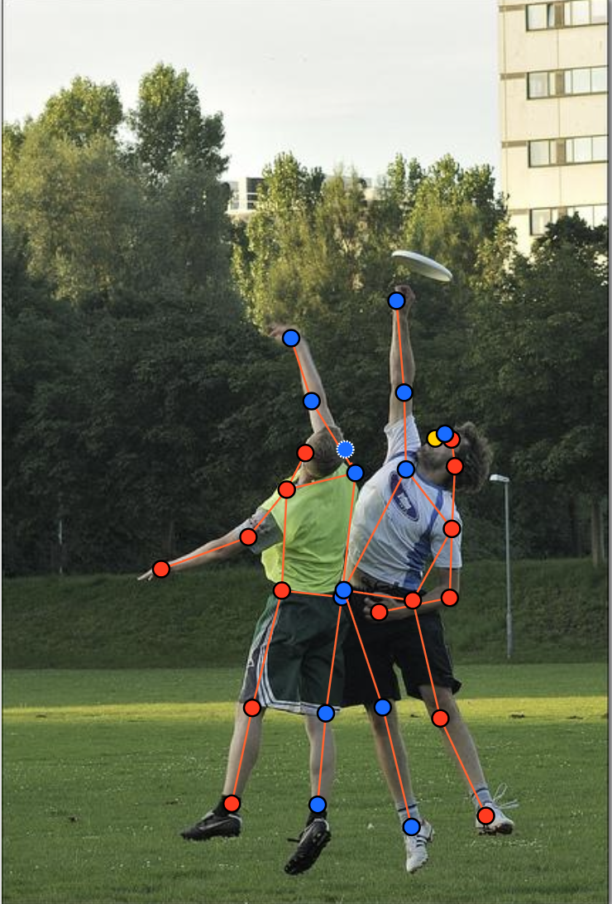
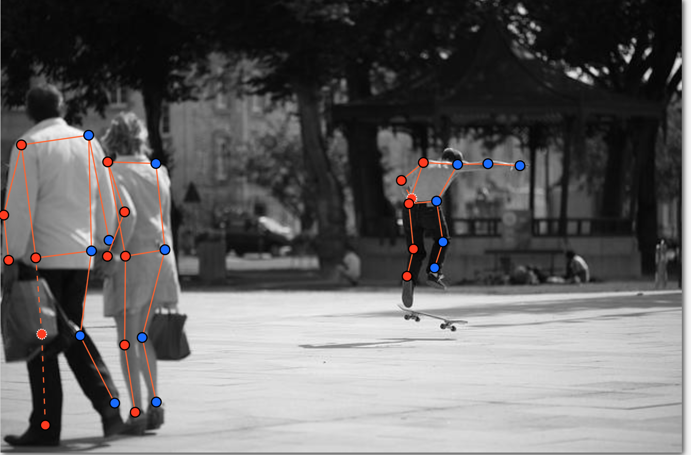
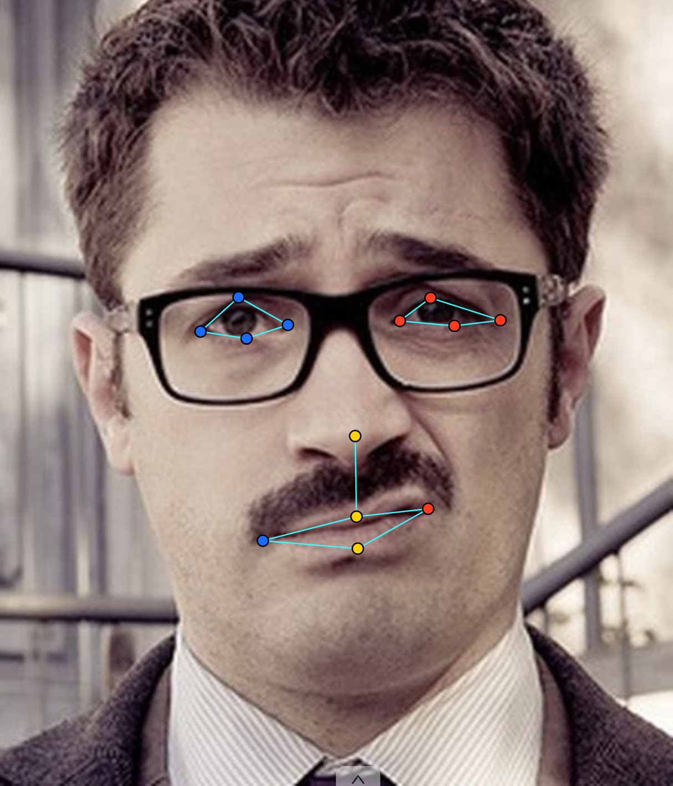
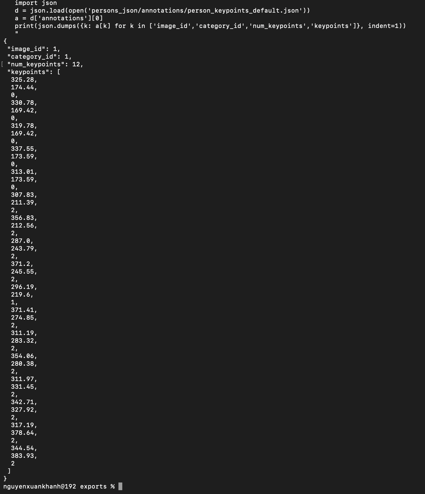

# Báo cáo cá nhân — HoVaTen-MSSV

Đổi tên file theo quy tắc `MSSV_HoTen.md`. Ví dụ: `20241234_NguyenVanAn.md`.

Dữ liệu: 12 ảnh người COCO val2017 (Lin et al., 2014) và 8 ảnh chân dung Wikimedia Commons, chỉ dùng trong lớp.

## 0. Thông tin học viên

- Họ tên: Nguyễn Xuân Khánh 
- MSSV:2A202603075
- Email:khanhblackjaky@gmail.com
- Link repository:https://github.com/Khanh-AI-ML-DL/K5-L2-Nguyen-Xuan-Khanh-03075-KeypointPose-Student.git
- Máy: macOS (MacBook Air) · RAM ⟦ĐIỀN⟧ GB (Docker được cấp 7.7 GB) · chạy CVAT chế độ ⟦đầy đủ / lite⟧
- Bộ ảnh (`src/exports/assignment.json` do `lab.py setup` tạo): có
- Giờ bắt đầu: 16h00
- Giờ kết thúc: 19h00

## 1. Kiểm tra label (CP0)

| Label | Kiểu | Số điểm | Tên điểm đúng bảng của lab? | Đúng thứ tự? | Số cạnh |
|---|---|---:|---|---|---:|
| `person` | skeleton | 17 | Có | Có | 51 |
| `face` | skeleton | 13 | Có | Có | 39 |

Mẫu `person` dựng theo người quay mặt về camera (các điểm `left_*` nằm bên phải khung mẫu)? Có 

Cách đổi cờ `occluded` / `outside` cho **một điểm** trên phiên bản CVAT này (một câu):

...

## 2. Số lượng đã gán và thời gian (CP1, CP2)

| Nhóm ảnh | Số ảnh | Số skeleton đã gán | Số người dưới 60 px (không gán) | Số poster / gương / màn hình bỏ qua | Thời gian (phút) |
|---|---:|---:|---:|---:|---:|
| `easy` | 5 | 5| | | |
| `occluded` | 3 |4 | | | |
| `back` | 2 | 4| | | |
| `small` | 1 | 0| | | |
| `crowd` | 1 | 3| | | |
| `faces` | 8 | 8| — | | |

- Số ảnh người đã xong ở mốc phút 105: 10 / 10
- Thời gian thực tế (phút): CP1 _20__ · CP2 _40__ · CP3 _20__
- Ảnh tốn thời gian nhất là ảnh nào, vì sao?
ảnh `crowd` 000000381889 có 3 người nên thường lâu nhất;
...

## 3. Bảng ca khó (CP1, CP2)

Mỗi điểm bạn phân vân một dòng, nhất là phân vân giữa `v = 1` và `v = 0`, hoặc không chắc hướng người.

|  Ảnh | Người / mặt | Điểm | Cờ đã chọn | Phân vân giữa | Lý do chọn |
|---|---|---|---:|---|---|
| 000000122199.jpg | người #1 | knee (hai đầu gối) | 1| trái/phải hay chân bắt chéo thật | Vẫn thấy được |
| 000000323705.jpg |  | toàn bộ | 0 | gán hay bỏ vì người nhỏ | không có người  |
 

## 4. Bảng tự review (CP3)

Đi từ ảnh cuối về ảnh đầu. 5 ảnh người (ít nhất 2 ảnh `back` hoặc `crowd`) và 3 ảnh mặt. Ít nhất 8 dòng, kể cả dòng `ok`. Ghi lỗi trước, sửa sau.

Mã lỗi dùng đúng một trong: `lr_swap`, `vis_flag`, `position`, `missing`, `extra`, `ok`.

| Ảnh | Người / mặt | Điểm | Mã lỗi | Ghi chú | Đã sửa? |
---|---|---|---|---|---|
| 000000122199.jpg | #1 | knee | lr_swap  | script cảnh báo knee ngược phía| Labcoach chấp nhận lỗi do ảnh |
| 000000323705.jpg | all | cả người | missing | script báo không có skeleton `person` | Ảnh ko có người |
Tổng hợp số lỗi theo mã:

| `lr_swap` | `vis_flag` | `position` | `missing` | `extra` | `ok` |
|---:|---:|---:|---:|---:|---:|
| | | | | | |

Điểm còn phân vân giữa `v = 1` và `v = 0` (ghi cả hai lựa chọn và lý do chọn):

...

## 5. Kiểm file xuất và kết quả tự kiểm (CP4)

Tự kiểm tay trong file JSON:

| File | Người / mặt kiểm (ảnh, thứ tự) | Số phần tử `keypoints` | Điểm `outside` ra `v = 0`, `occluded` ra `v = 1`? | `num_keypoints` khớp? |
|---|---|---:|---|---|
|---|---|---:|---|---|
| `NguyenXuanKhanh_persons.zip` | ⟦ảnh, người 1⟧ | 51 | Có | Có |
| `NguyenXuanKhanh_persons.zip` | ⟦ảnh, người 2⟧ | 51 | có | Có |
| `NguyenXuanKhanh_faces.zip` | ⟦ảnh, mặt 1⟧ | 39 | Có | Có |

Sau khi xuất, CVAT ghi `occluded` thành `v = 1` và `outside` thành `v = 0`. Tọa độ của điểm `outside` trong file là `0, 0` hay tọa độ cũ? ___

Hai job đã chuyển sang completed trên CVAT? Có / Không
Có
Dán phần **TÓM TẮT** in ra từ `src/check_submission.py`:

```text
- File person: NguyenXuanKhanh_persons.zip
  Số ảnh: 12 · số skeleton `person`: 16 · mỗi annotation 51 số
  Skeleton theo ảnh: 000000054909=2, 000000057978=1, 000000122199=2, 000000210604=2, 000000294329=1, 000000323705=0, 000000365099=1, 000000381889=3, 000000445187=1, 000000461389=1, 000000463932=1, 000000516902=1
  Cờ v: v=2 203 (75%) · v=1 29 (11%) · v=0 40 (15%)
  num_keypoints trung bình: 14.5
- File face: NguyenXuanKhanh_faces.zip
  Số ảnh: 8 · số skeleton `face`: 8 · mỗi annotation 39 số
  Skeleton theo ảnh: face_122747=1, face_185015=1, face_186226=1, face_223746=1, face_232598=1, face_255797=1, face_257657=1, face_38721=1
  Cờ v: v=2 97 (93%) · v=1 7 (7%) · v=0 0 (0%)
  num_keypoints trung bình: 13.0
- Ghi chú: 40 điểm v = 0 vẫn mang tọa độ cũ (CVAT 2.x xuất như vậy; chuẩn COCO ghi 0, 0). Không phải lỗi: điểm v = 0 bị bỏ qua khi huấn luyện và khi chấm.
- Số [LỖI]: 0 · số [CẢNH BÁO]: 2
Kết quả: ĐẠT (đọc lại từng cảnh báo ở trên)

```

Các `[CẢNH BÁO]` còn giữ nguyên và lý do:

- Được labCoach check qua rồi

## 6. Ảnh chụp màn hình

1. Label `person` trong label constructor (đủ 17 điểm có tên):

   

2. Một người quay lưng đã gán, cờ đã đặt:

   

3. Một khuôn mặt đã gán 13 điểm, phóng to vùng mắt:

   

4. Một đoạn JSON xuất của một người:

   

Nguồn ảnh: COCO val2017 / Wikimedia Commons.

## 7. Tự đánh giá

1. Lỗi bạn mắc nhiều nhất hôm nay, và cách bạn sẽ tránh ở dự án thật:

   ...

2. Một quy tắc bạn đề xuất thêm vào guideline (kèm ảnh ví dụ nếu có):

   ...

3. Nhãn của bạn đi vào model ở đâu? Chọn một lỗi bạn đã sửa và nói nó sẽ làm model học sai thế nào (heatmap, trọng số trong loss, hay bước lật ảnh):

   ...

## 8. Khó khăn và lỗi kỹ thuật

...

## Bonus (nếu làm)

### B1 — 3 ảnh người khó thêm

| Ảnh | Số skeleton | Số người dưới 60 px | Ca khó nhất |
|---|---:|---:|---|
| | | | |
| | | | |
| | | | |

Kết quả `src/check_submission.py` cho `NguyenXuanKhanh_bonus_persons.zip`:

```text

=== src/exports/NguyenXuanKhanh_bonus_persons.zip (label `person`) ===

----- TÓM TẮT (dán vào báo cáo mục 5) -----
- File person: NguyenXuanKhanh_bonus_persons.zip
  Số ảnh: 3 · số skeleton `person`: 8 · mỗi annotation 51 số
  Skeleton theo ảnh: 000000323525=3, 000000337458=2, 000000465508=3
  Cờ v: v=2 80 (59%) · v=1 3 (2%) · v=0 53 (39%)
  num_keypoints trung bình: 10.4
- Ghi chú: 53 điểm v = 0 vẫn mang tọa độ cũ (CVAT 2.x xuất như vậy; chuẩn COCO ghi 0, 0). Không phải lỗi: điểm v = 0 bị bỏ qua khi huấn luyện và khi chấm.
- Số [LỖI]: 0 · số [CẢNH BÁO]: 0
Kết quả: ĐẠT
nguyenxuankhanh@192 K5-L2-Nguyen-Xuan-Khanh-03075-KeypointPose-Student % 
```

### B2 — 5 ảnh khuôn mặt đen trắng / hồng ngoại

Ảnh không màu khó hơn ở điểm nào? Kính râm trên ảnh hồng ngoại có còn là `v = 1` không?

Kính râm hồng ngoại có gọi là `v=1`

### B3 — Model so với nhãn của tôi (không tính điểm)

- Demo đã dùng:
- Ảnh đã thử:

1. Model có trả điểm cho khớp bị che, hay khớp ngoài ảnh không? Confidence ở các điểm đó thế nào?

   ...

2. Với người quay lưng, model có đổi trái/phải không?

   ...

3. Bộ điểm của model có giống 17 điểm COCO không?

   ...

## 9. Tài liệu tham khảo và công cụ AI đã dùng
- CVAT 2.74.1 (annotation tool).
- Claude (Anthropic): hỗ trợ xử lý lỗi Git/GitHub, chạy `lab.py`, và soạn khung báo cáo. 
